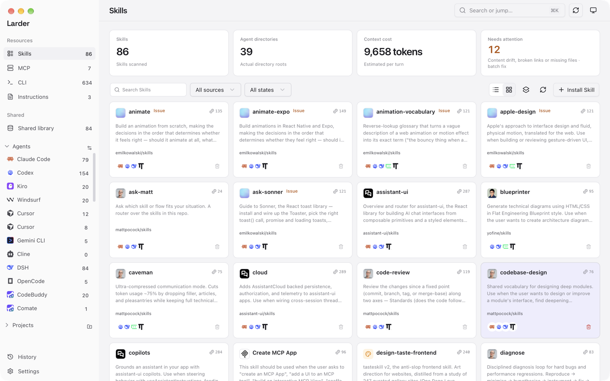
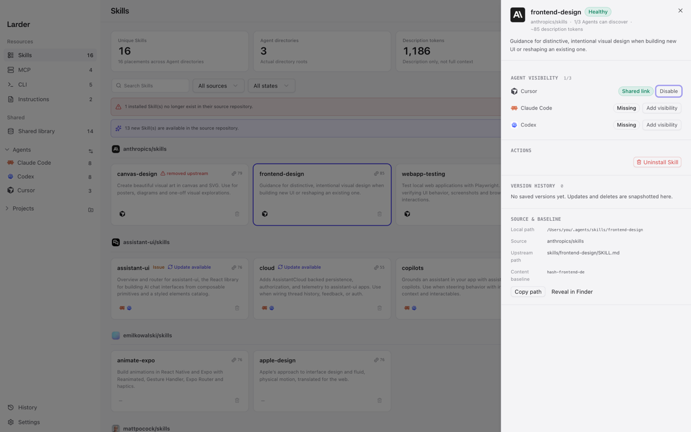
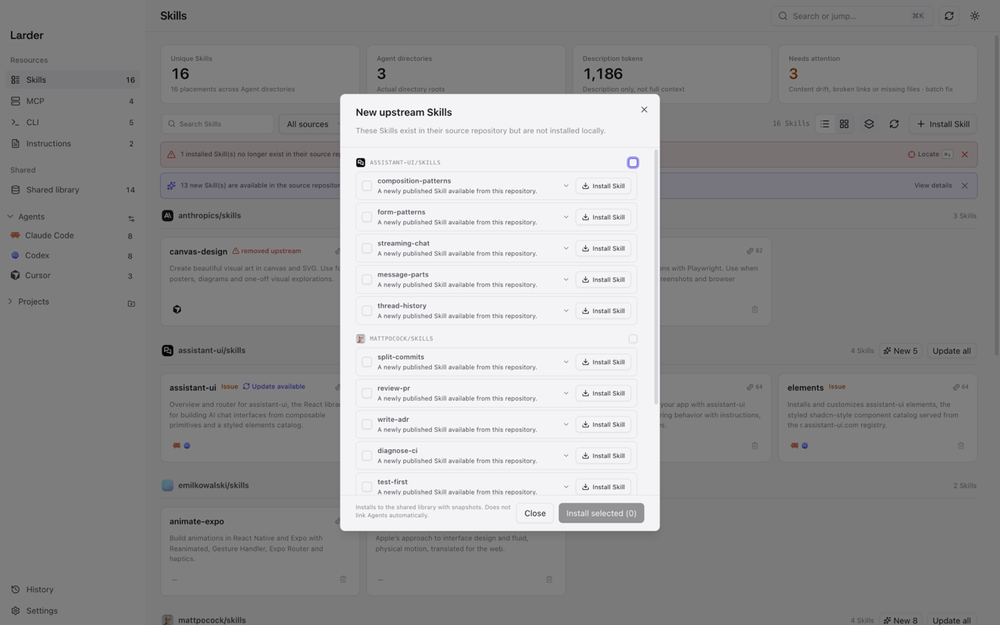
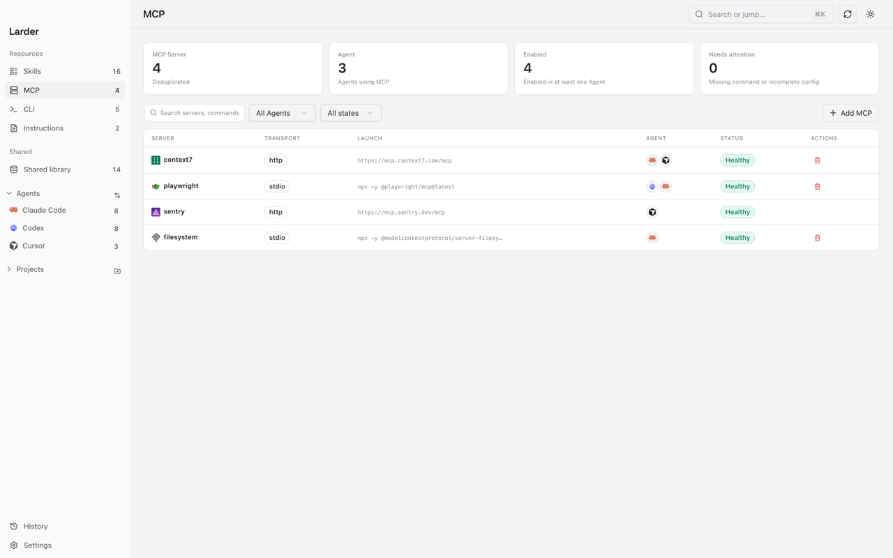
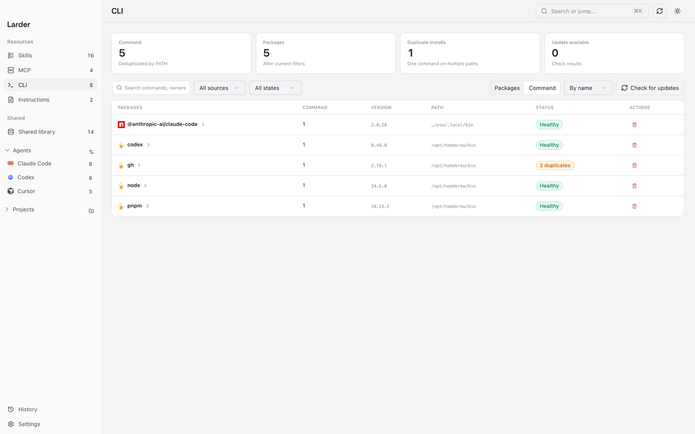
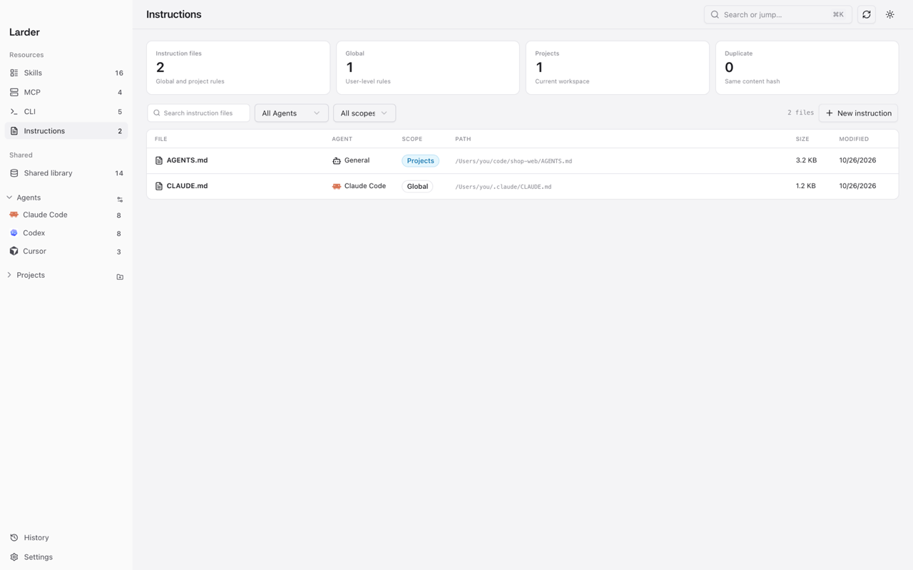
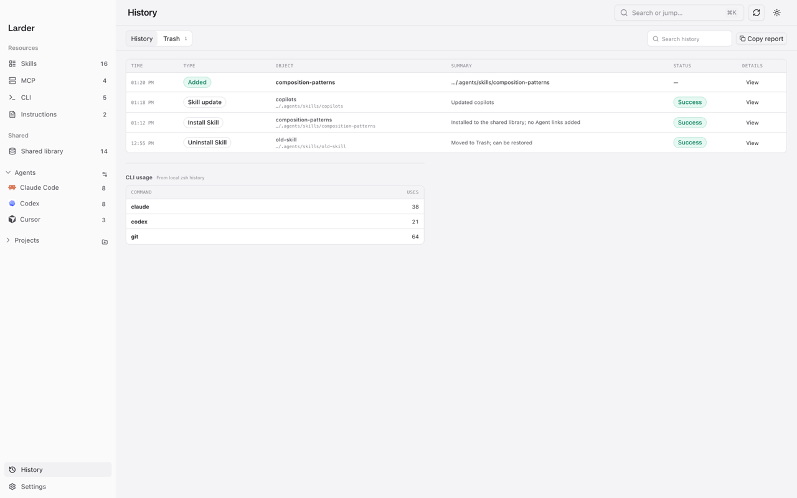
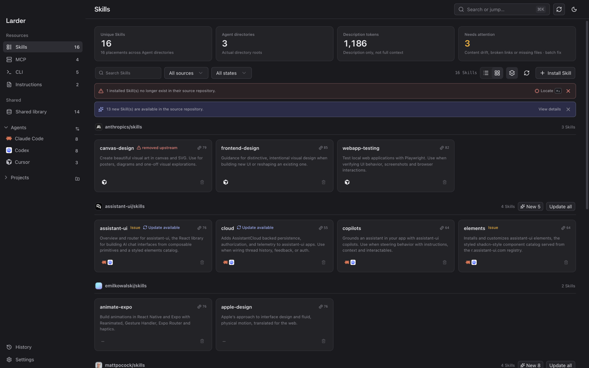
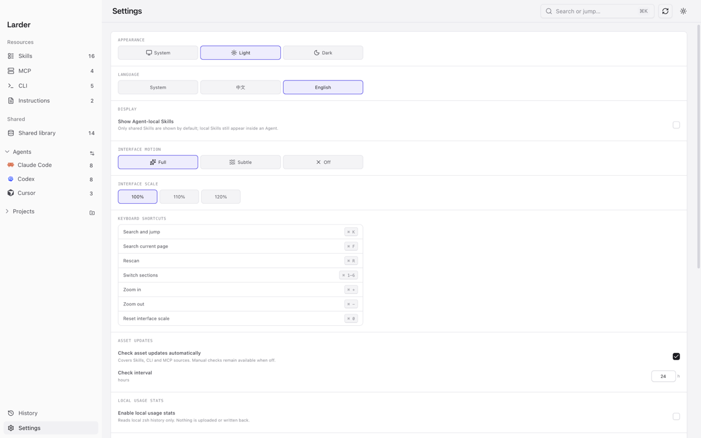

# Larder

**Local provisions for your agents.**

[English](README.md) · [简体中文](README.zh-CN.md)

Larder is a local-first desktop app for developers who work with multiple AI agents. It shows what is actually installed on your machine — Skills, MCP servers, CLI tools, instruction files, and custom Agent commands — and lets you manage them safely.

<p align="center"></p>

## What it does

- **Skills** — scan every Agent directory and shared library, inspect sources, token cost and visibility, then install, update, uninstall, repair links or sync copies.
- **Agent Inspector** — see what an Agent statically sees and why: visible Skills, duplicates, missing links, instruction files and context budget. Read-only.
- **MCP servers** — inspect global and project configuration, add or edit servers, toggle them per Agent, and test whether a command or URL is reachable.
- **CLI tools** — see what is installed, which package manager owns it, duplicates and available updates. Update or uninstall through the package manager.
- **Instruction files** — scan `AGENTS.md`, `CLAUDE.md`, Cursor rules and Copilot instructions. Preview Markdown or raw content, edit existing files, or create new ones.
- **Commands** — scan custom slash commands for Claude Code, Cursor, OpenCode, Gemini CLI and GitHub Copilot. Create or edit them through a plan and snapshot; Codex prompts are not supported by current Codex releases and use Skills instead.
- **App updates** — check GitHub Releases, download a verified app archive, install it in place and restart Larder.
- **Projects** — see the Skills, MCP servers and instruction files that belong to a project in one place.
- **Language** — switch between English and Chinese in Settings; the app follows the system language on first launch.

## Screenshots

<table>
<tr>
<td width="50%" valign="top">
<br />
<strong>Skill detail</strong><br />
Source, Agent visibility and the next safe action.
</td>
<td width="50%" valign="top">
<br />
<strong>Review upstream additions</strong><br />
See new Skills before installing one or a batch.
</td>
</tr>
<tr>
<td width="50%" valign="top">
<br />
<strong>MCP servers</strong><br />
Transport, launch command, status and Agent visibility.
</td>
<td width="50%" valign="top">
<br />
<strong>CLI tools</strong><br />
Owners, PATH duplicates and available updates.
</td>
</tr>
<tr>
<td width="50%" valign="top">
<br />
<strong>Instruction files</strong><br />
Scan, preview and edit global or project instructions.
</td>
<td width="50%" valign="top">
<br />
<strong>History and rollback</strong><br />
Every write keeps a snapshot that can be restored.
</td>
</tr>
<tr>
<td width="50%" valign="top">
<br />
<strong>Light and dark</strong><br />
Light, dark or system appearance.
</td>
<td width="50%" valign="top">
<br />
<strong>Settings</strong><br />
Language, motion, zoom and update preferences.
</td>
</tr>
</table>

## Safe by default

Larder reads local files before it writes anything.

- Every write has a visible action or plan.
- Configuration files are snapshotted before modification.
- Failures are shown instead of silently ignored.
- Local data stays local. No account, no file upload, no telemetry.

## Build from source

Requirements:

- macOS 13+ (current primary platform)
- Windows 10 1809+ / 11 (build and acceptance path included; WebView2)
- Go 1.26+
- Node.js 24+
- Wails v3 CLI

macOS is the current primary target. The Windows build and test path is already in the repository; more desktop platforms are planned.

```sh
git clone <repo-url>
cd larder
./scripts/run.sh
```

Useful scripts:

```sh
./scripts/run.sh    # build if needed, then open the app
./scripts/dev.sh    # development mode with frontend hot reload
./scripts/build.sh  # rebuild the app
```

There is no signed release build yet.

On macOS, a locally built app may require:

```sh
xattr -dr com.apple.quarantine /path/to/Larder.app
```

On Windows, an unsigned build may show a SmartScreen warning.

## Status

`0.0.8` — early development. The current focus is local truth, safe writes, and a clearer view of what each Agent actually sees.

## License

[MIT](LICENSE)
