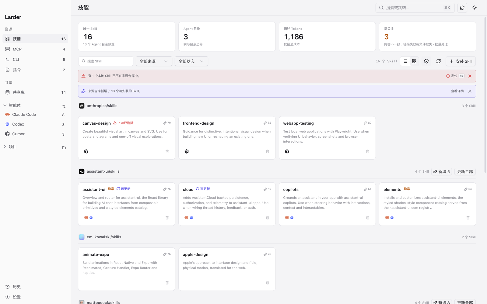
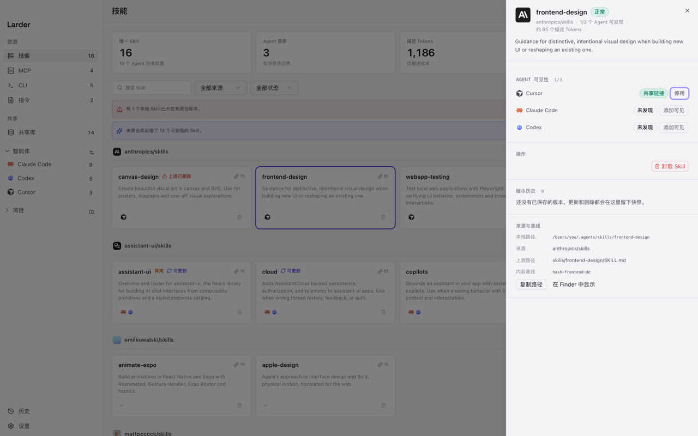
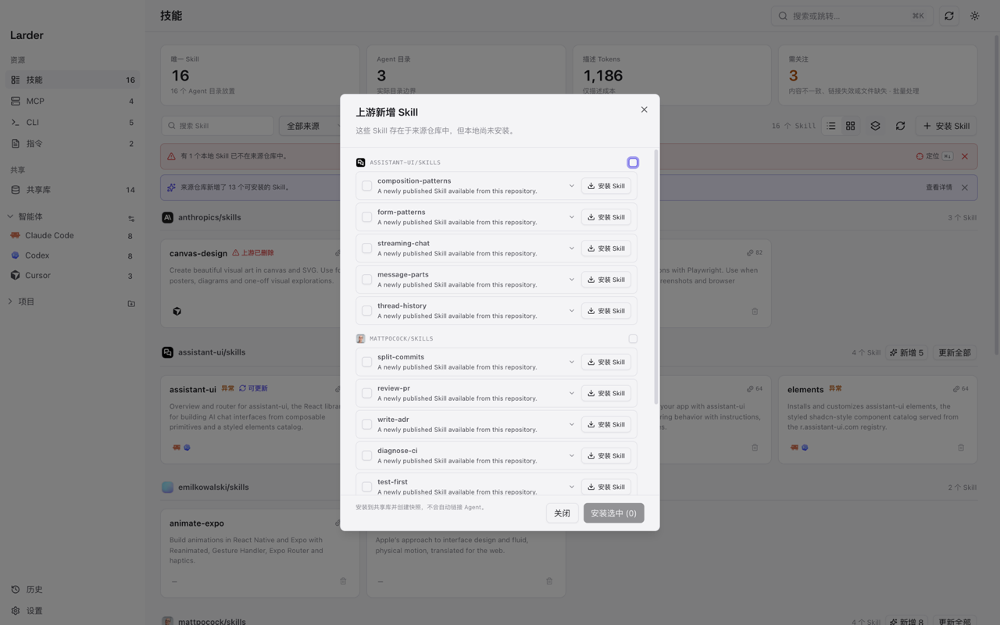
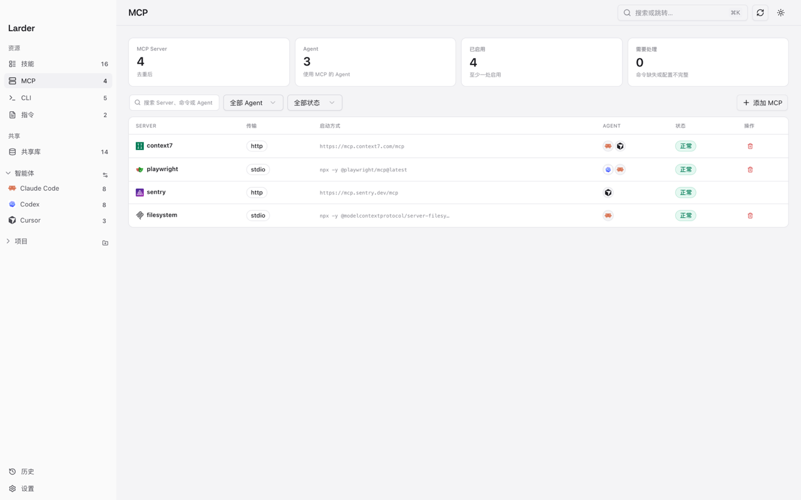
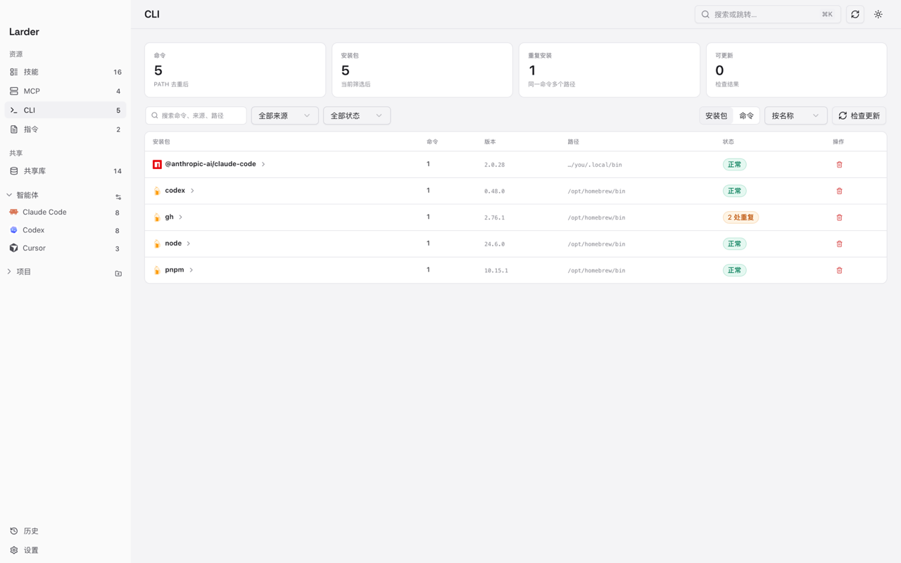
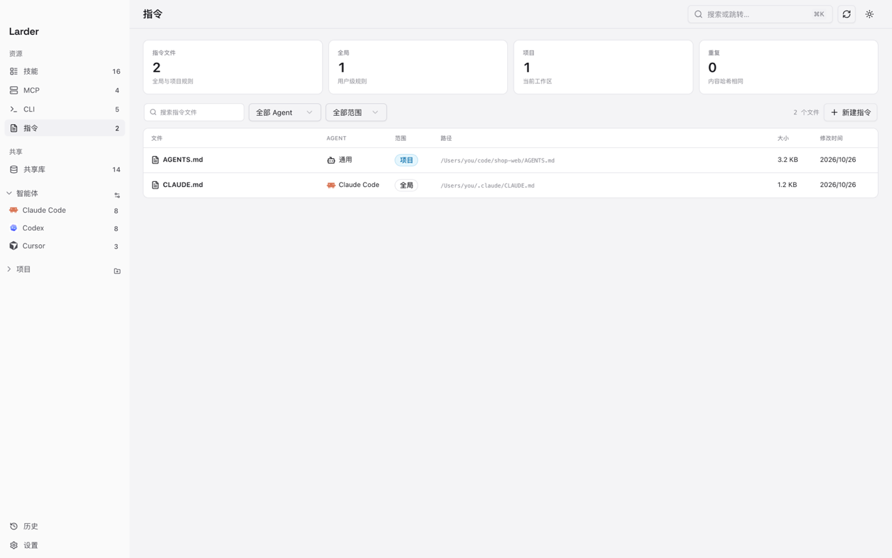
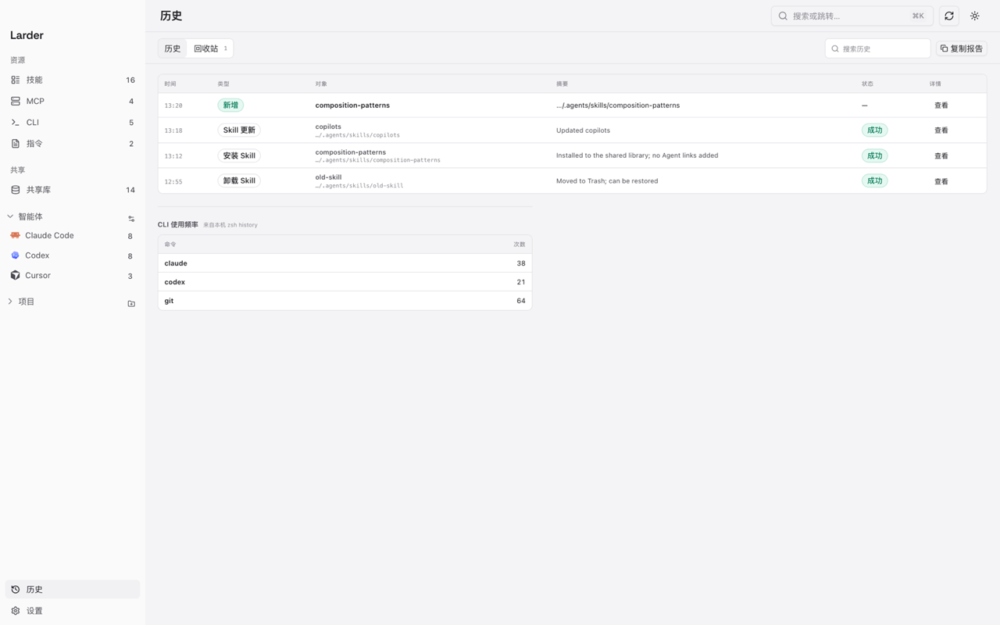
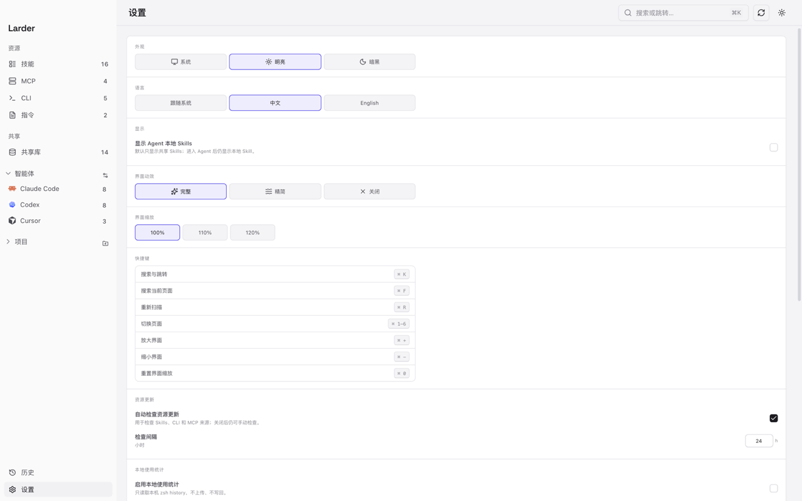

# Larder

**为 Agent 准备的本机储备。**

[English](README.md) · [简体中文](README.zh-CN.md)

Larder 是一个本地优先的桌面应用，面向同时使用多个 AI Agent 的开发者。它把本机真实存在的 Skills、MCP Server、CLI 和指令文件集中展示出来，并让你安全地管理它们。

<p align="center"></p>

## 能做什么

- **Skills**：扫描共享库和各个 Agent 目录，查看来源、上下文成本和可见性；支持安装、更新、卸载、修复链接和同步副本。
- **MCP Server**：查看全局和项目配置，添加或编辑 Server，按 Agent 启停，并测试命令或 URL 是否可用。
- **CLI 工具**：查看已安装命令、所属包管理器、重复安装和可用更新；通过包管理器更新或卸载。
- **指令文件**：扫描 `AGENTS.md`、`CLAUDE.md`、Cursor rules 和 Copilot instructions；支持 Markdown 预览、原文查看、编辑和新建。
- **项目**：在一个页面里看到项目自己的 Skills、MCP 和指令文件。
- **语言**：在设置中切换中文和英文；首次启动会跟随系统语言。

## 截图

<table>
<tr>
<td width="50%" valign="top">
<br />
<strong>Skill 详情</strong><br />
来源、Agent 可见性和下一步安全动作。
</td>
<td width="50%" valign="top">
<br />
<strong>上游新增，先看再装</strong><br />
安装前查看来源，支持单选和批量安装。
</td>
</tr>
<tr>
<td width="50%" valign="top">
<br />
<strong>MCP Server</strong><br />
传输方式、启动命令、状态和 Agent 可见性。
</td>
<td width="50%" valign="top">
<br />
<strong>CLI 工具</strong><br />
所属包管理器、PATH 重复项和可用更新。
</td>
</tr>
<tr>
<td width="50%" valign="top">
<br />
<strong>指令文件</strong><br />
扫描、预览和编辑全局或项目指令。
</td>
<td width="50%" valign="top">
<br />
<strong>历史与回滚</strong><br />
每次写入都有快照，可查看并恢复。
</td>
</tr>
<tr>
<td width="50%" valign="top">
<br />
<strong>亮色与暗色</strong><br />
支持亮色、暗色和跟随系统。
</td>
<td width="50%" valign="top">
<br />
<strong>设置</strong><br />
语言、动效、缩放和更新偏好。
</td>
</tr>
</table>

## 默认安全

Larder 先读本机真实文件，再考虑写入。

- 每个写操作都有明确动作或计划。
- 修改配置文件前会生成快照。
- 失败会显示出来，不会被静默吞掉。
- 数据留在本机：不需要账号，不上传文件，没有遥测。

## 从源码运行

环境要求：

- macOS 13+（当前主平台）
- Windows 10 1809+ / 11（已包含构建与验收路径；WebView2）
- Go 1.26+
- Node.js 24+
- Wails v3 CLI

目前以 macOS 为主要开发目标；仓库已经包含 Windows 构建和测试路径，后续会覆盖更多桌面平台。

```sh
git clone <repo-url>
cd larder
./scripts/run.sh
```

常用脚本：

```sh
./scripts/run.sh    # 没有构建时先构建，然后打开应用
./scripts/dev.sh    # 开发模式，前端热更新
./scripts/build.sh  # 重新构建应用
```

目前还没有签名发布包。

在 macOS 上，本机构建的应用可能需要：

```sh
xattr -dr com.apple.quarantine /path/to/Larder.app
```

在 Windows 上，未签名构建可能显示 SmartScreen 提示。

## 当前状态

`0.0.3` — 早期开发阶段。当前重点是本机真实状态、安全写入，以及 Skills 和 MCP 的日常工作流。

## 许可

[MIT](LICENSE)
